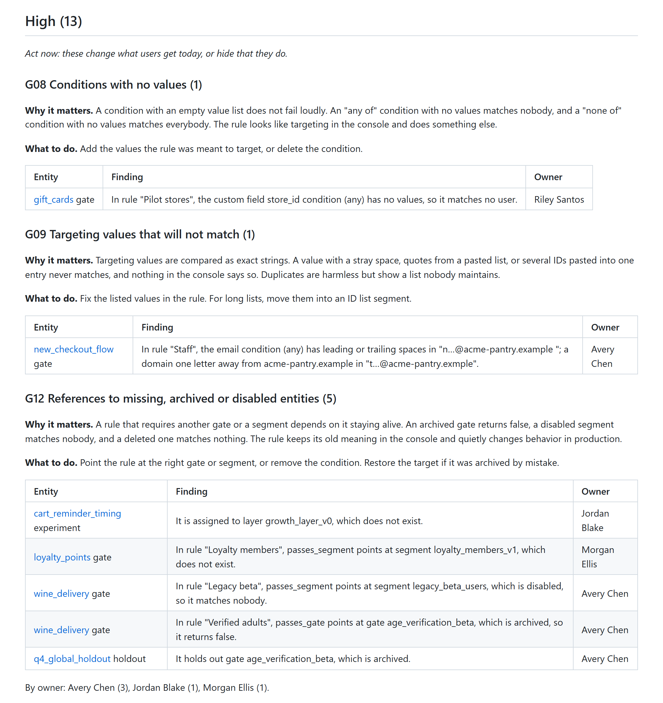

<h1 align="center">statsig-audit</h1>

<p align="center"><em>Unofficial. Not affiliated with, endorsed by, or sponsored by Statsig or its owners. Statsig is a trademark of its respective owner.</em></p>

<p align="center"><strong>A read-only hygiene audit for your Statsig project: stale gates, forgotten rollouts, broken targeting, experiments past their plan, metric trust. Markdown or JSON report, CI friendly.</strong></p>

<p align="center">
<a href="#quickstart"><strong>Quickstart</strong></a> ·
<a href="#checks">Checks</a> ·
<a href="#github-action">GitHub Action</a> ·
<a href="#claude-plugin">Claude plugin</a> ·
<a href="SECURITY.md">Security</a> ·
<a href="PRIVACY.md">Privacy</a>
</p>

<p align="center"><a href="https://github.com/ardaasaroglu/statsig-audit/actions/workflows/ci.yml"></a></p>

<p align="center"></p>

<p align="center"><sub>Part of the <a href="examples/sample-report.md">sample report</a>, made from a fictional project.</sub></p>

## What it does

statsig-audit reads your project through the Statsig Console API, runs 25 checks, and writes one report that says what to clean up, why, and who owns it.

* **It finds what drifts.** Gates left at 100% for months, partial rollouts nobody finished, experiments running weeks past their plan, rules that point at archived gates or disabled segments, targeting lists with a stray space, and primary metrics nobody verified.
* **It complements Statsig.** Statsig already marks stale gates and dynamic configs. The audit lists those with their owner and age, applies its own rules to experiments that are decided but not cleaned up or running past their plan, and flags what Statsig does not: broken references, unreachable rules, targeting values that never match, rule churn and more. Each check in [docs/checks.md](docs/checks.md) says where it overlaps.
* **It only reads.** The HTTP client sends GET requests and nothing else. It never calls the endpoint that returns API keys, and never starts a code cleanup.
* **It fits CI.** `--fail-on high` turns findings into an exit code, and the JSON report has a [documented schema](docs/json-format.md).

## Quickstart

You need Node.js 20 or newer.

**1. Create a read-only Console API key.** In the Statsig console, open Project Settings, Environments & Keys, and create a Console API key with a read-only scope: `omni_read_only`, or `personal_read_only` for a personal key. Those are the scope names in Statsig's API, and the console may label them differently. The audit needs nothing more.

**2. Put the key in the environment.** It is read from `STATSIG_CONSOLE_API_KEY` and from nowhere else. No option takes a key, so there is no reason to type one on a command line, where it would land in shell history. To type it without echoing it:

```bash
read -rs STATSIG_CONSOLE_API_KEY && export STATSIG_CONSOLE_API_KEY
```

```powershell
# PowerShell 7.1 or newer
$env:STATSIG_CONSOLE_API_KEY = Read-Host -MaskInput "Console API key"

# Windows PowerShell 5.1
$env:STATSIG_CONSOLE_API_KEY = [Net.NetworkCredential]::new('', (Read-Host -AsSecureString "Console API key")).Password
```

**3. Run it.**

```bash
npx github:ardaasaroglu/statsig-audit#v0.2.0 --out statsig-audit-report.md
```

The report goes to the file, and a one-line summary to the terminal. Without `--out`, the report is printed. Add `--format json` for JSON.

`#v0.2.0` pins a release tag, so the code that receives your key does not change under you. Without it, npx installs whatever is on `main` at that moment. Move to a newer tag on purpose, after reading its [changelog](CHANGELOG.md).

**Try it without a key.** The repository holds a snapshot of a fictional project:

```bash
git clone https://github.com/ardaasaroglu/statsig-audit.git
cd statsig-audit
node cli/statsig-audit.js --input test/fixtures/snapshot.json --config examples/.statsig-audit.json
```

That prints the [sample report](examples/sample-report.md).

## Reading the report

Findings are grouped by severity, then by check. Each group says why it matters and what to do, and each finding names the entity, links to it in the console and names its owner.

| Severity | Meaning |
| --- | --- |
| High | Act now. It changes what users get today, or hides that it does. |
| Medium | Plan it this quarter. Cleanup and process gaps that grow if left alone. |
| Low | Hygiene. Cheap fixes that keep the project easy to read. |

The **hygiene score** is the share of audited entities with no high or medium finding, from 0 to 100. It counts gates, dynamic configs, experiments, segments, custom metrics, explicit layers and holdouts that are not archived. It is a ratio for tracking one project over time, not a benchmark.

A check that needs data the run did not collect, such as G14 without `--users`, is listed under "Checks that could not run". It is never counted as clean.

The Markdown report lists up to 50 findings per check and severity. The JSON report lists all of them.

### Options

| Option | What it does |
| --- | --- |
| `--format markdown\|json` | Report format. Default: markdown. |
| `--out <file>` | Write the report to a file instead of stdout. |
| `--fail-on high\|medium\|low\|none` | Exit with 1 when a finding is at or above this severity. Default: none. |
| `--config <file>` | Config file. Default: `.statsig-audit.json` in the working directory, when it exists. |
| `--checks <ids>` | Run only these checks, for example `G01,E03`. |
| `--audit-log-days <n>` | Days of audit log to read, 1 to 90. Default: 30. |
| `--deep` | Make one detail call per candidate to confirm G06 (production checks in the last 7 days) and E03 (exposures against the target). |
| `--users` | Read the project member list, which G14 needs. |
| `--show-emails` | Show email addresses. By default they are masked, as in `a…@example.com`. |
| `--input <file>` | Audit a saved snapshot instead of calling the API. |
| `--save-snapshot <file>` | Save the data read from the API. It holds project data, never the key. |
| `--now <date>` | Count ages to this ISO date-time. Default: now, or the snapshot time with `--input`. |
| `--summary <file>` | Also append the Markdown report to this file, for `$GITHUB_STEP_SUMMARY`. |
| `--github-output <file>` | Append finding counts as `key=value` lines, for `$GITHUB_OUTPUT`. |
| `--verbose` | Log each request and step to stderr. |
| `--help`, `--version` | Show the help or the version. |

| Exit code | Meaning |
| --- | --- |
| 0 | Done, and no finding at the `--fail-on` level. |
| 1 | Done, with findings at the `--fail-on` level. |
| 2 | A usage, config or input problem, or a check that failed to run. |
| 3 | The Statsig API could not be read: a rejected key, a missing permission, rate limits or the network. |

### Configuration

Put a `.statsig-audit.json` next to where you run the tool, or pass `--config`. Every key is optional, and unknown keys are errors, so a typo never turns a setting off silently.

```json
{
  "$schema": "https://raw.githubusercontent.com/ardaasaroglu/statsig-audit/main/docs/config.schema.json",
  "checks": { "disable": ["N01"] },
  "thresholds": { "gateCleanupDays": 90, "partialRolloutDays": 45 },
  "naming": { "pattern": "^[a-z0-9]+(_[a-z0-9]+)*$" },
  "ignore": [
    { "check": "G04", "id": "checkout_holdback", "reason": "A 5% holdback on purpose." },
    { "id": "legacy_kill_switch" }
  ],
  "auditLogDays": 30
}
```

Every threshold and its default is listed in [docs/config.schema.json](docs/config.schema.json) and next to the check it affects in [docs/checks.md](docs/checks.md). Ignored findings are left out of the counts, the score and the exit code, and listed at the end of the report with their reason.

## GitHub Action

```yaml
- uses: actions/checkout@v7 # only needed for a .statsig-audit.json in the repository
- uses: ardaasaroglu/statsig-audit@306ed40f7e8be3c53e15f28398bb0483acfa9bbc # v0.1.0
  id: audit
  with:
    fail-on: high
  env:
    STATSIG_CONSOLE_API_KEY: ${{ secrets.STATSIG_CONSOLE_API_KEY }}
```

The action receives your key, so the example pins it to the full commit of a release, like the `#v0.2.0` tag for npx. `@v0` also works and follows the latest 0.x release.

The action writes the report to `statsig-audit-report.md` (or `.json`) and to the job summary, and fails the step when `fail-on` is met. Inputs: `fail-on`, `format`, `output`, `config`, `checks`, `deep`, `users`, `input` and `job-summary`. Outputs: `report`, `findings`, `high`, `medium`, `low` and `score`. It runs the `node` already on the runner, which must be version 20 or newer. GitHub-hosted runners include Node.js. On a self-hosted runner, add `actions/setup-node` before it.

[examples/workflows/weekly-audit.yml](examples/workflows/weekly-audit.yml) runs the audit every Monday and keeps the report as an artifact.

The report names your gates, experiments and owners. In a public repository, anyone can read job summaries and download artifacts, so run the audit from a private repository.

## Claude plugin

[plugin/](plugin/) is a Claude plugin with one skill. It works on claude.ai, in Cowork and in Claude Code, and it needs no key.

It reads your project through a Statsig MCP connection that you add yourself (Statsig's MCP server at `https://api.statsig.com/v3/mcp`, with your own Statsig sign-in), and only with read tools. It writes the data to a snapshot in a temporary directory, audits it with a bundled offline copy of the engine, and deletes it. Then it writes an action plan: this week (high), this quarter (medium, by owner) and hygiene (low). It can also audit a snapshot file saved with `--save-snapshot`, or a fictional sample project, with no Statsig account at all. The plugin itself makes no network calls, and it is told never to call a create, update, delete, archive or cleanup tool.

Install it from Claude's plugin directory once it is listed there. In Claude Code, you can also install it from this repository:

```bash
claude plugin marketplace add ardaasaroglu/statsig-audit
claude plugin install statsig-audit@statsig-audit
```

Then connect Statsig's MCP server (`claude mcp add --transport http statsig https://api.statsig.com/v3/mcp`, then `/mcp` to sign in) and ask for an audit, or run `/statsig-audit:audit`. [plugin/README.md](plugin/README.md) covers claude.ai and Cowork, example prompts and troubleshooting, and [PRIVACY.md](PRIVACY.md) says what the plugin reads and sends.

The engine copy in `plugin/skills/audit/scripts/engine/` is generated from `src/` by `npm run build:plugin`, and CI fails when it is out of date.

## Checks

| Id | Check | Severity |
| --- | --- | --- |
| G01 | Gates Statsig marked stale, with reason, owner and age | medium |
| G02 | Launched or disabled gates past their cleanup window (60 days) | medium |
| G03 | In-progress gates that serve everyone the same value | medium |
| G04 | Partial rollouts left alone | medium |
| G06 | Gates with no traffic (`--deep` confirms) | medium |
| G08 | Conditions with no values | high |
| G09 | Targeting values that will not match: stray spaces, quotes, pasted lists, domain typos | high, medium or low |
| G10 | The same ID list pasted into several entities | medium |
| G11 | Rules that can never run, below an everyone rule | medium |
| G12 | References to missing, archived or disabled gates, segments and layers | high |
| G13 | Missing description, owner or tags | low |
| G14 | Owners who are no longer project members (`--users`) | medium |
| D01 | Dynamic configs Statsig marked stale | medium |
| E02 | Decided or abandoned experiments not cleaned up | medium |
| E03 | Experiments running past their plan (`--deep` adds exposure targets) | medium |
| E04 | Experiments without a hypothesis or the right metrics | high while running |
| E05 | Several comparisons with no correction | medium |
| E06 | Running experiments with failing health checks | high or medium |
| E09 | Experiments whose targeting gate lets nobody in | high |
| X01 | Layers no experiment uses | low |
| X02 | Segments nothing uses, and empty ID lists | low |
| X03 | Running experiments decided by unverified or hidden metrics | medium |
| A01 | Gates and configs whose rules keep changing | medium, high without review |
| A02 | No required review for changes | medium |
| N01 | Names off convention, scratch entities and tag drift | low |

[docs/checks.md](docs/checks.md) gives each check's exact rule, why it matters, how to fix it, its overlap with Statsig's own features and its settings.

## What it does not do

* **It does not change anything.** No writes, no archiving, no code cleanup. Fixing is up to you, in the console and in your code.
* **It does not read your code.** To find and remove stale flags in code, use Statsig's own code cleanup tools or a refactoring tool such as Piranha. This report tells you which flags to start with.
* **It does not replace Statsig's stale detection.** It reuses Statsig's stale flags and health checks, and adds checks around them.
* **It does not judge results.** It looks at how experiments are set up and maintained, not at their statistics.
* **It does not read API keys.** It never calls the endpoint that lists them.

## Security

* The key is read only from `STATSIG_CONSOLE_API_KEY`, sent only in a request header to `https://statsigapi.net`, and removed from every output, including error messages that echo it back. A test runs the CLI with a fake key on success and on six kinds of failure, and fails if the key appears anywhere.
* The HTTP client refuses every method but GET before a request is made, refuses the keys and code cleanup endpoints, and does not follow redirects.
* Requests are throttled to 10 per second and 850 per 15 minutes. A 429 or a 5xx is retried with exponential backoff and jitter, at most four times.
* Owner emails are masked in reports unless you pass `--show-emails`. Dynamic config values, rule return values and audit log change bodies are never written to a snapshot.

[SECURITY.md](SECURITY.md) has the details and says how to report a vulnerability. [PRIVACY.md](PRIVACY.md) says what the CLI, the Action and the Claude plugin read, send and store.

## FAQ

**Is this an official Statsig tool?** No. It is an independent open-source project that uses the public Console API.

**Why is there no `--key` option?** A key typed on a command line lands in shell history and in the process list. No option takes a key, so there is no reason to type one there. The CLI refuses `--key` and similar flags with an explanation, without echoing the value.

**How many requests does a run make?** One per 100 entities in each list, about ten lists in all, plus one per candidate with `--deep`. A project with a few hundred entities needs a few dozen requests.

**Can I audit without network access, or share a run?** Save a snapshot with `--save-snapshot`, then audit it anywhere with `--input`. The snapshot holds project data, so treat it like the report.

**Does it work with Warehouse Native projects?** It uses the same Console API endpoints, which Statsig documents as identical for Cloud and Warehouse Native. It has no checks specific to Warehouse Native yet.

**Why did a check not run?** The report lists every check that could not run and why: a list the key may not read (HTTP 403), or data that needs `--users` or `--deep`.

## Limitations

* The test suite runs against fictional data and a local mock of the Console API, modelled on Statsig's published OpenAPI spec (version 20240601). Field meanings come from that spec and Statsig's docs. If the API changes, a check may miss things until it is updated.
* G06 relies on Statsig's sampled `checksPerHour` unless you add `--deep`.
* References from overrides are not read, so X02 can call a segment unused when only an override uses it.
* X03 reports a missing primary metric only for metric types that live in the catalog, because event metrics may not be listed.
* The audit log window is at most 90 days, and A01 looks at the last 7 days of it by default.
* Statsig's console labels and key scopes can differ by plan. Quickstart step 1 describes the usual path.

## Contributing

Small, focused changes are welcome. Read [CONTRIBUTING.md](CONTRIBUTING.md) first. `npm test` runs every test with no dependencies to install. Ideas for checks are welcome as [issues](https://github.com/ardaasaroglu/statsig-audit/issues). To report a security problem, see [SECURITY.md](SECURITY.md).

## License

MIT. See [LICENSE](LICENSE).

Statsig is a trademark of its respective owner and is named here only to say what this tool works with.
